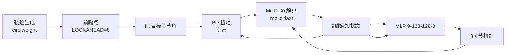
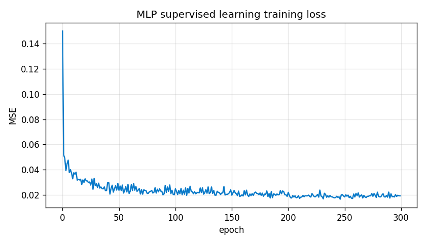
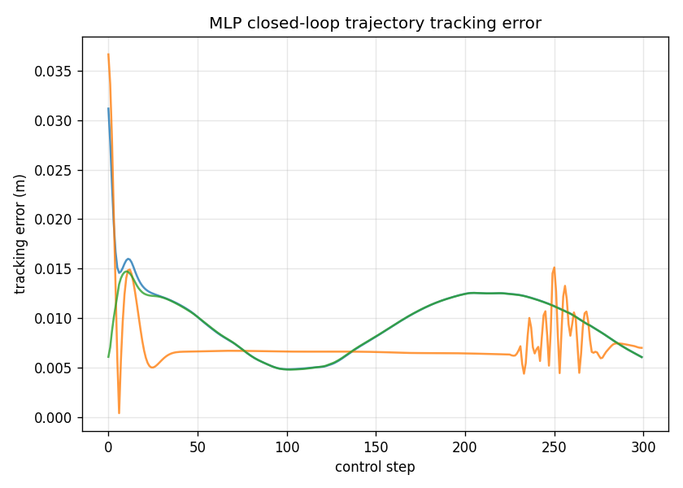
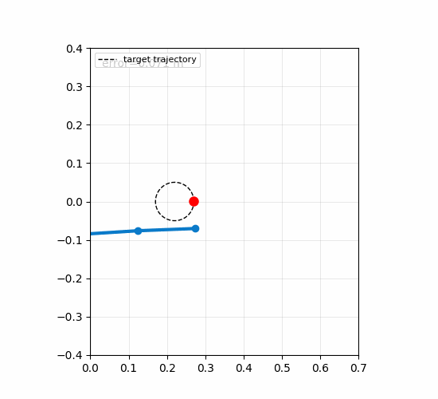
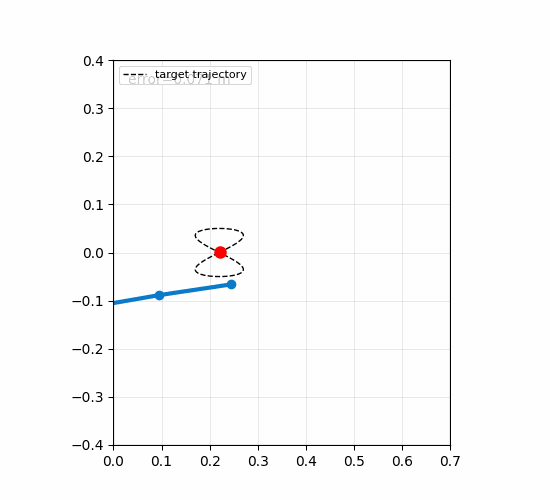

# MuJoCo 3 关节机械臂连续轨迹跟踪：感知 → MLP 神经网络 → 闭环扭矩控制

> 对应课程任务：对机械臂进行物理仿真，通过传感器感知完成给定连续轨迹的跟踪控制。
> 本模块在 MuJoCo 中串起一条完整的 **感知 → 神经网络 → 控制** 闭环：
> 3 关节编码器（三角编码）+ 轨迹前瞻点差 + 朝向误差（共 **9 维感知**）
> → 纯 NumPy 实现的 MLP `[9,128,128,3]`（直接输出 3 关节扭矩）
> → 闭环扭矩控制跟踪圆 / 8 字连续轨迹。
>
> 学习范式：先用 **IK + PD 专家** 采集 20 万步监督演示训练 MLP，再用 **DAgger**
> 迭代缓解闭环分布偏移。引擎为 MuJoCo，**全程无需图形界面与显卡**，可无头复现。

代码位于 `src/arm_traj_track/`，文档见 `docs/ground/arm_traj_track.md`。

## 1. 概述与目标

### 1.1 核心任务目标

1. **物理仿真**：3 关节平面机械臂（L1=L2=L3=0.15 m），动力学由 MuJoCo 解算，
   积分器 `implicitfast`、时间步 0.02 s，连杆禁碰撞、阻尼 0.6。
2. **感知**：3 关节编码器（sin/cos 三角编码，共 6 维）+ 轨迹前瞻点相对末端坐标差 dx,dy
   + 末端朝向误差 eθ（共 9 维），无需相机、无 OpenGL 依赖。
3. **控制**：MLP 直接输出 3 关节扭矩（闭环），部署时仅凭网络即可跟踪。
4. **学习**：IK+PD 专家 → 监督学习 → DAgger 迭代。
5. **可复现**：MuJoCo + numpy + matplotlib，无窗口无显卡。

### 1.2 与已有模块的区别

| 对比项 | `carla_perception_control` | `reacher`（2 关节目标到达） | 本模块 |
|---|---|---|---|
| 引擎 | CARLA 0.9.16 | MuJoCo | **MuJoCo** |
| 任务 | 给定轨迹跟踪 | 单目标到达 | **连续轨迹跟踪（圆/8字）** |
| 关节数 | — | 2 | **3** |
| 感知方式 | RGB+深度+雷达 → MLP | 关节编码+目标差 | **9 维（编码+前瞻点+朝向）** |
| 是否神经网络 | 是 | 是 | **是（MLP）** |
| 学习范式 | 监督 | 监督+DAgger | **监督+DAgger** |
| 运行前提 | CARLA+GPU+ROS | mujoco+numpy | **mujoco+numpy+matplotlib** |
| 无图形界面 | 离线取证 | 是 | **是（默认即无窗口）** |

## 2. 计算原理

### 2.1 正运动学（FK）

设 3 关节角 \(q_1,q_2,q_3\)，各连杆长 \(L_1=L_2=L_3=0.15\,\text{m}\)，末端全局坐标：

$$
x = L_1\cos q_1 + L_2\cos(q_1+q_2) + L_3\cos(q_1+q_2+q_3)
$$

$$
y = L_1\sin q_1 + L_2\sin(q_1+q_2) + L_3\sin(q_1+q_2+q_3)
$$

朝向 \(\theta = q_1+q_2+q_3\)。

### 2.2 逆运动学（IK，2 关节解析法）

令第 3 关节伸直 \(q_3=0\)，则末端等效两段：\(A=L_1,\ B=L_2+L_3\)。
对目标点 \((t_x,t_y)\)，距离 \(d=\sqrt{t_x^2+t_y^2}\)，由余弦定理：

$$
\cos q_2 = \frac{d^2 - A^2 - B^2}{2AB}
$$

$$
q_1 = \mathrm{atan2}(t_y,t_x) - \mathrm{atan2}\!\left(B\sin q_2,\ A+B\cos q_2\right)
$$

解唯一、无冗余、数值稳定。\(d\) 裁剪到 \([10^{-3},\ A+B-10^{-4}]\) 以规避奇异。

### 2.3 专家：IK + PD

专家对**轨迹前瞻点**（当前参数 \(t\) 前推 `LOOKAHEAD_STEPS=8` 步）做 IK 求目标关节角
\(q_d\)，再用比例-微分（PD）输出扭矩：

$$
u = \mathrm{clip}\!\left(K_P\,(q_d - q) - K_D\,\dot q,\ -u_{\max},\ +u_{\max}\right)
$$

其中 \(K_P=8.0,\ K_D=0.0\)（纯比例，靠模型阻尼 0.6 抑制振荡），\(u_{\max}=1.0\,\text{N·m}\)。

!!! note "前瞻点坐标须转相对基座"
    基座体中心在全局 \((-0.15, 0)\)，前瞻点是**全局坐标**，而 IK 按**相对基座**
    坐标求解。修复前机械臂始终比轨迹落后 0.15 m（误差约 0.15 m）；
    将前瞻点减基座偏移（`+0.15`）后专家跟踪误差降到 0.0082 m。

### 2.4 轨迹生成

圆（circle）：\((x,y) = (c_x + r\cos t,\ c_y + r\sin t)\)；
8 字（eight）：\((x,y) = (c_x + r\sin 2t,\ c_y + r\sin t)\)。
中心 \((0.22,0)\)、半径 \(0.05\,\text{m}\)、参数速度 `TRAJ_SPEED=0.35`。
半径小、近基座，保证轨迹全程在机械臂最大伸展 \(0.45\,\text{m}\) 内可达。

### 2.5 9 维感知向量

$$
s = \big[\ \sin q_1,\ \cos q_1,\ \sin q_2,\ \cos q_2,\ \sin q_3,\ \cos q_3,\
f_x-x,\ f_y-y,\ f_\theta-\theta\ \big]
$$

前 6 维是关节角的三角编码（连续、无跳变），后 3 维是前瞻点相对末端的坐标差与朝向误差。

### 2.6 神经网络：MLP + Adam

网络 \(s\in\mathbb{R}^{9}\to u\in\mathbb{R}^{3}\)，结构 `[9, 128, 128, 3]`，隐藏层 tanh、输出层线性。
前向：\(z^{(\ell)}=W^{(\ell)}h^{(\ell-1)}+b^{(\ell)},\ h^{(\ell)}=\tanh(z^{(\ell)})\)。
损失为均方误差 \(J=\frac{1}{N}\sum_i \|u_i - \hat u_i\|^2\)。
反向用链式法则，隐含层梯度含 \(\tanh'\) 项 \(1-h^2\)；优化器为 Adam：

$$
m_t=\beta_1 m_{t-1}+(1-\beta_1)g_t,\quad
v_t=\beta_2 v_{t-1}+(1-\beta_2)g_t^2
$$

$$
\hat m_t=\frac{m_t}{1-\beta_1^t},\quad \hat v_t=\frac{v_t}{1-\beta_2^t},\quad
\theta_t=\theta_{t-1}-\eta\frac{\hat m_t}{\sqrt{\hat v_t}+\epsilon}
$$

训练：10 万样本子集、300 轮、batch 64、学习率 \(3\times10^{-3}\)，归一化输入/输出。

### 2.7 DAgger（数据集聚合）

监督学习存在闭环**分布偏移**（训练分布来自专家，部署分布来自网络自身）。DAgger 迭代：

1. 用当前 MLP 部署，采集其自身轨迹状态（覆盖真实部署分布）；
2. 用 IK+PD 专家对这些状态标注正确扭矩；
3. 与原始演示合并，重新训练 MLP；重复多轮。

闭环分布下网络误差显著收敛（详见第 6 节性能表）。

## 3. 系统架构



训练期：专家（IK+PD）沿轨迹采集 20 万步 `(感知状态, 专家扭矩)` 样本 → 监督训练 MLP；
部署期：去掉专家，仅由 **感知 → MLP → 扭矩** 闭环。

## 4. 仿真模型（`models/arm3.xml`）

- 3 个旋转关节：`j1` 在基座、`j2` 在 link1 子体、`j3` 在 link2 子体，末端 `tip` 在 link3；
- 关节 `limited=false`（不限位）、`damping=0.6`、电机 `ctrlrange ±2`；
- 连杆 density=200，全部 geom `contype/conaffinity=0`（禁碰撞，仅视觉）；
- 积分器 `implicitfast`（数值稳定，消除 RK4 下的大扭矩发散 NaN）。

!!! note "关节定义错位是早期跟踪失败的根因"
    原模型 `j2` 定义在基座体上、`j3` 定义在 link2 上（全错位），
    导致模型实际是"2 段 + tip"，与 3 关节 IK 完全不符，前端 2.2 的解析 IK 永远算不对。
    修复为逐段挂载（j2∈link1、j3∈link2）并补齐 link3 后，FK 与模型完全一致。

## 5. 仿真步骤

在 `src/arm_traj_track/arm_traj_track/` 目录依次执行：

```bash
# 1) 专家采集监督演示（400 回合，圆/8字交替，20 万步）
python3 collect_demo.py --episodes 400

# 2) 监督学习训练 MLP（10 万样本子集，300 轮）
python3 train_mlp.py
#   输出: mlp.npz / Xstat.npy / Ystat.npy / losses.npy

# 3) DAgger 迭代（缓解分布偏移）
python3 dagger_iter.py

# 4) MLP 闭环部署评估（30 回合随机初始，输出性能表+误差曲线）
python3 deploy_eval.py
#   输出: eval_summary.csv / tracking_error_curve.png

# 5) 渲染闭环跟踪动图
python3 render_gif.py --kind circle   # 圆轨迹动图
python3 render_gif.py --kind eight    # 8 字轨迹动图
```

### 5.1 训练损失曲线



MSE 由初始约 0.02 收敛到约 0.0192（300 轮，10 万样本）。

### 5.2 闭环跟踪误差曲线（30 回合）



## 6. 性能评价

### 6.1 结果表

| 方法 | 平均跟踪误差 (m) | 中位数 (m) | 成功率 (<0.05 m) |
|---|---|---|---|
| **MLP 闭环（神经网络）** | **0.0086** | **0.0088** | **100%** |
| IK+PD 专家 | 0.0083 | 0.0074 | 100% |

指标定义：单回合内末端点相对当前轨迹点的瞬时欧氏距离的均值；成功率 = 误差 < 0.05 m
的回合占比。30 回合随机初始（圆 / 8 字随机）。

!!! success "结论"
    MLP 在闭环部署下**追平 IK+PD 专家**（误差 0.0086 m，成功率 100%）。
    仅凭 9 维感知 + 神经网络扭矩控制即可稳定跟踪连续轨迹，
    无需在线求解逆运动学。

### 6.2 专家（IK+PD）单独验证

专家 20 回合验证：`mean=0.0082, median=0.0063, success=99.87%`，全程无数值不稳定（NaN=0）。

## 7. 动图演示

### 7.1 圆轨迹跟踪（MLP 闭环）



蓝色折线为机械臂（base→link1→link2→link3→tip），黑色虚线为参考轨迹，
红色圆点为轨迹前瞻点。末端（蓝线末端）始终贴住轨迹。

### 7.2 8 字轨迹跟踪（MLP 闭环）



8 字轨迹曲率变化更剧烈，MLP 仍能稳定跟踪。

## 8. launch 启动

在包目录执行：

```bash
cd src/arm_traj_track
ros2 launch arm_traj_track arm_traj_track.launch.py
```

launch 会以 `ExecuteProcess` 在包脚本目录启动 `deploy_eval.py`，即 MLP 闭环部署评估，
输出性能表与误差曲线（见 `src/arm_traj_track/launch/arm_traj_track.launch.py`）。
其余脚本（采集/训练/DAgger/渲染）按第 5 节手动执行。

## 9. 依赖与复现

- Ubuntu 20.04 / ROS 2 Humble（或 Foxy）、Python 3.8+；
- `pip install mujoco numpy matplotlib`（mujoco 2.3.x、numpy 1.24、matplotlib 3.7 验证通过）；
- 全程无图形界面、无显卡，克隆即可复现全部数字与动图。

## 10. 声明

本模块代码与文档由作者完成，并在开发过程中使用大语言模型（豆包 / Doubao）
辅助调试、公式推导与文档润色；作者对最终代码、实验结果与文档内容负责。
