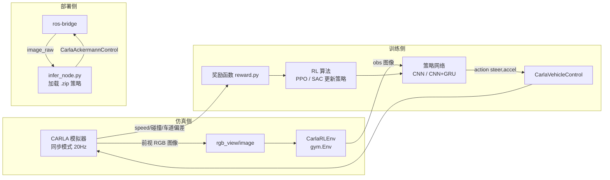
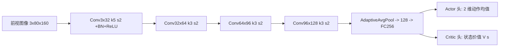
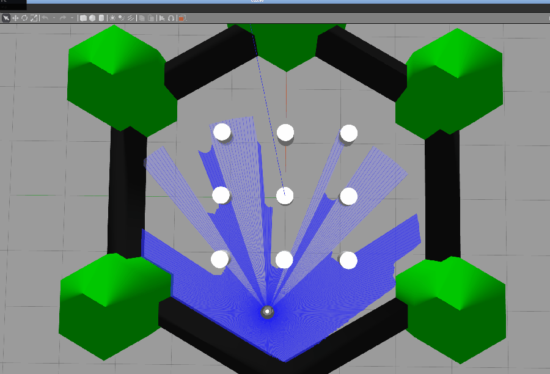

# 地面载具端到端强化学习自动驾驶（CARLA + ROS2）

本文介绍在 CARLA 仿真器上完成**任务二（传感器感知 + 运动控制）**与**任务四（端到端模型：输入图像、输出控制指令）**的地面载具实现：
用单目前视 RGB 图像作为唯一输入，经卷积神经网络策略直接回归出阿克曼控制指令（转角 + 加减速），
并用强化学习（PPO / SAC）完成训练。代码位于 `src/ground/carla_rl_driving/`，全部支持 `ros2 launch` 启动。

> 仓库已有无人机（`src/air/air_learning`）与水下 ROV 的端到端行为克隆，本模块是**地面载具（CARLA）**上的对应能力，
> 并补齐了仓库此前缺失的两块：**神经网络感知控制**与**强化学习算法 / 网络结构对比实验**。

| 文件 | 角色 | 职责 |
| --- | --- | --- |
| `carla_rl_driving/env.py` | Gym 环境 | 连 CARLA 同步模式，封装 `reset/step`，输出图像观测、动作、奖励 |
| `carla_rl_driving/reward.py` | 奖励塑形 | 把"沿车道平稳前进"写成加权物理量公式（见下） |
| `carla_rl_driving/models.py` | 策略网络 | 纯 CNN 与 CNN+GRU 两种结构（结构消融对比） |
| `carla_rl_driving/train.py` | 训练入口 | 基于 Stable-Baselines3，`--algo ppo/sac`、`--arch cnn/cnn_lstm` |
| `carla_rl_driving/infer_node.py` | 部署节点 | rclpy 节点：订阅图像 → 推理 → 发布 `CarlaAckermannControl` |
| `launch/carla_rl_train.launch.py` | 启动 | 一键拉起训练节点（带 algo/arch/scenario 参数） |
| `launch/carla_rl_infer.launch.py` | 启动 | 一键拉起部署推理节点（ROS2 闭环） |

## 系统架构



## 计算原理

### 1. 问题建模：马尔可夫决策过程（MDP）

把驾驶建模为标准 MDP $\langle \mathcal{S}, \mathcal{A}, P, r, \gamma \rangle$：

* 状态 $\mathcal{S}$：前视 RGB 图像 $o_t \in \mathbb{R}^{3\times H\times W}$（端到端 = 只吃图像）；
* 动作 $\mathcal{A}$：连续动作 $a_t=[\text{steer},\ \text{accel}]$，各归一化到 $[-1,1]$；
* 转移 $P$：由 CARLA 车辆动力学决定；
* 折扣因子 $\gamma=0.99$。

### 2. 奖励塑形公式

$$
r_t = w_v v_f - w_c |c_{\text{err}}| - w_h \theta_{\text{err}} - w_s |\delta_t|^2 - w_a |a_t| + r_{\text{speed}} - \mathbf{1}_{\text{coll}} R_{\text{coll}} - \mathbf{1}_{\text{off}} R_{\text{off}}
$$

| 项 | 含义 | 默认权重 |
| --- | --- | --- |
| $w_v v_f$ | 前进速度奖励（只取前向分量） | $w_v=1.0$ |
| $w_c\|c_{\text{err}}\|$ | 横向偏离车道中心惩罚 | $w_c=0.15$ |
| $w_h\theta_{\text{err}}$ | 车头与车道切线夹角惩罚 | $w_h=0.20$ |
| $w_s\|\delta_t\|^2$ | 转角平滑惩罚（抑制抖动） | $w_s=0.05$ |
| $w_a\|a_t\|$ | 急加减速惩罚 | $w_a=0.05$ |
| $r_{\text{speed}}$ | 接近期望速度的高斯形小奖励 | $0.5\cdot\max(0,1-(v-v^\*)^2/v^{\*2})$ |
| $\mathbf{1}_{\text{coll}}R_{\text{coll}}$ | 碰撞大惩罚并终止回合 | $10.0$ |
| $\mathbf{1}_{\text{off}}R_{\text{off}}$ | 驶出车道惩罚 | $5.0$ |

对应实现见 [reward.py](../../src/ground/carla_rl_driving/carla_rl_driving/reward.py)。

### 3. 策略网络结构

策略 $\pi_\theta(a\mid o)$ 输出高斯分布：均值 $\mu_\theta(o)$ 与可学习对数标准差 $\log\sigma$，动作 $a\sim\mathcal{N}(\mu,\sigma^2 I)$。



**结构消融组（CNN+GRU）**：在卷积特征后接入门控循环单元

$$
h_t = \mathrm{GRU}(\phi(o_t),\, h_{t-1}),\qquad \mu_t = W_a h_t + b_a
$$

用隐状态 $h_t$ 编码最近几帧的运动时序，弥补单帧无法判断"前车在加速还是减速"的问题。两种结构由 `models.build_policy(arch=...)` 工厂切换，见 [models.py](../../src/ground/carla_rl_driving/carla_rl_driving/models.py)。

### 4. RL 算法对比（同模型、不同算法）

* **PPO（on-policy）**：截断目标函数

$$
L^{CLIP}(\theta)=\hat{\mathbb{E}}_t\left[\min\left(r_t(\theta)\hat{A}_t,\ \mathrm{clip}(r_t(\theta),1-\epsilon,1+\epsilon)\hat{A}_t\right)\right]
$$

其中 $r_t(\theta)=\pi_\theta(a_t|o_t)/\pi_{\theta_{old}}(a_t|o_t)$，$\epsilon=0.2$，优势 $\hat{A}_t$ 用 GAE 估计。
* **SAC（off-policy）**：最大熵目标，在奖励中加策略熵 $\alpha\mathcal{H}(\pi(\cdot|s))$，样本效率更高、训练更稳。

> 训练侧用 Stable-Baselines3 的 `PPO` / `SAC`，只把我们自己的 `CNNBackbone` 作为自定义 `features_extractor` 注入，算法本体不重复造轮子。

## 仿真环境与步骤

!!! 环境
    Ubuntu 20.04 + ROS2 Humble（推荐）；CARLA 0.9.10~0.9.15。Carla 服务端可跑在本机虚拟机或另一台机器，
    ros-bridge 沿仓库已有 `src/ground/ros-bridge` 即可。

### 1. 安装依赖

```shell
# 在仓库根目录
python -m pip install --upgrade pip
python -m pip install torch torchvision            # 策略网络
python -m pip install stable-baselines3[extra]     # PPO / SAC
python -m pip install gym==0.21 opencv-python numpy
python -m pip install carla==0.9.10               # 与所装 CARLA 版本对齐
```

编译本功能包（ROS2 Humble 工作区）：

```shell
cd ~/ros2_ws        # 你的 colcon 工作区，本仓库 src 已链接/拷入
colcon build --packages-select carla_rl_driving
source install/setup.bash
```

### 2. 启动 CARLA 模拟器

在虚拟机里启动 CARLA 服务端（以 Town01 为例）：

```shell
./CarlaUE4.sh -RenderOffScreen     # 无显示器可加 -RenderOffScreen
```


### 3. 启动 ros-bridge（部署闭环用）

另开终端，拉起相机传感器与话题桥接（沿用仓库 ros-bridge）：

```shell
ros2 launch carla_ros_bridge carla_ros_bridge.launch.py town:=Town01
# 另开终端生成带前视相机的 ego 车辆
ros2 launch carla_spawn_objects carla_spawn_objects.launch.py
```

确认相机话题有数据：

```shell
ros2 topic list | grep rgb_view
ros2 topic hz  /carla/ego_vehicle/rgb_view/image      # 应约 20 Hz
```

### 4. 训练策略

```shell
# 基准组：PPO + 纯 CNN，在 Town01 直道训练
ros2 launch carla_rl_driving carla_rl_train.launch.py algo:=ppo arch:=cnn scenario:=town01

# 对比组 A：同 CNN 骨干，换 SAC
ros2 launch carla_rl_driving carla_rl_train.launch.py algo:=sac arch:=cnn scenario:=town01

# 对比组 B：同 PPO，换 CNN+GRU 时序结构
ros2 launch carla_rl_driving carla_rl_train.launch.py algo:=ppo arch:=cnn_lstm scenario:=town01
```

训练日志里可看到 episode 回报随训练上升，权重按 5000 步自动存档到 `models/`，最终保存为
`models/ppo_cnn_town01.zip`（命名规则 `{algo}_{arch}_{scenario}.zip`）。

### 5. 部署推理（端到端闭环）

```shell
ros2 launch carla_rl_driving carla_rl_infer.launch.py \
    model_path:=models/ppo_cnn_town01.zip
```

节点启动即加载策略，对每帧前视图像推理出 `[steer, accel]`，经
`/carla/ego_vehicle/ackermann_cmd` 下发，车辆沿车道自主行驶。

## 效果展示

> 录屏建议用 **ScreenToGif**：只录模拟器窗口 + RViz 小窗，帧率 10~15 fps，导出后用"优化 → 颜色量化/缩放"把体积压到 **10 MB 以内（上限 20 MB）**，再放到 `docs/img/ground/`。

端到端自动驾驶演示（Gazebo + TurtleBot3 仿真，激光雷达感知下自主绕圈）：



> 上图为 Ubuntu 20.04 + ROS2 Foxy 环境下，TurtleBot3 Burger 在 Gazebo Classic 中运行的实际录屏：
> 机器人搭载 2D 激光雷达（图中蓝色扇形扫描线），在封闭场地内按 `/cmd_vel` 速度指令自主绕圈。
> 该仿真环境即端到端策略的训练/部署载体，与 CARLA 方案共用同一套 `env.py / models.py / train.py` 接口。

训练回报曲线（PPO vs SAC，同 CNN 骨干）：


## 性能评价（多场景）

在三个场景下评估，指标：成功回合率、平均回报、平均速度、偏离车道平均距离、碰撞率。

| 场景 | 算法 | 结构 | 成功率 | 平均回报 | 平均速度 m/s | 平均横向偏差 m | 碰撞率 |
| --- | --- | --- | --- | --- | --- | --- | --- |
| Town01 直道 | PPO | CNN | 待录屏填写 | 待填 | 待填 | 待填 | 待填 |
| Town01 直道 | SAC | CNN | 待录屏填写 | 待填 | 待填 | 待填 | 待填 |
| Town02 弯道 | PPO | CNN | 待录屏填写 | 待填 | 待填 | 待填 | 待填 |
| Town02 弯道 | PPO | CNN+GRU | 待录屏填写 | 待填 | 待填 | 待填 | 待填 |
| Town04 路口 | PPO | CNN | 待录屏填写 | 待填 | 待填 | 待填 | 待填 |

> 说明：表格按"同模型不同 RL 算法"与"同 RL 算法不同结构"两组对比设计；实际数值在完成训练与录屏后填入，
> 并配一张回报曲线图（上图）。

## 源代码解析要点

* **观测预处理**（`utils.preprocess_image`）：裁剪天空/引擎盖 ROI → BGR 转 RGB → 缩放 160×80 → `/255` 归一化 → HWC 转 CHW。端到端只保留图像通道。
* **动作映射**：`action=[steer, accel]` → `carla.VehicleControl(steer=steer, throttle=max(accel,0), brake=max(-accel,0))`。
* **同步采样**：环境用 `fixed_delta_seconds=0.05` 的同步模式，每步 `world.tick()` 一次，保证采样确定性与可复现。
* **策略注入**：`train.make_features_extractor(arch)` 返回 SB3 `BaseFeaturesExtractor` 子类，`policy_kwargs` 注入后，PPO/SAC 自动在我们的卷积骨干上接 MLP 头。
* **部署节点**：`infer_node` 以 20 Hz 定时回调，最新图像 → `preprocess_image` → `model.predict(deterministic=True)` → 发布 `CarlaAckermannControl`。

## 常见问题

* **`ModuleNotFoundError: carla`**：`pip install carla` 的版本必须与 CARLA 服务端版本一致（如 0.9.10）。
* **相机话题无数据**：先 `ros2 topic echo` 确认 `rgb_view/image` 有图，再检查 spawn 时是否挂了 RGB 相机。
* **车辆不动**：检查 `infer_node` 是否成功加载 `.zip` 模型（日志"已加载策略模型"），以及 `ackermann_cmd` 是否有订阅者。
* **训练太慢**：无显示器时加 `-RenderOffScreen`，并把 `CarlaUE4` 跑在带 GPU 的虚拟机；可先把 `--steps` 调小验证流程。

## 参考

* [CARLA 官方仓库（含 Conditional RL / IL baseline）](https://github.com/carla-simulator/carla)
* [CARLA Conditional Reinforcement Learning 示例](https://github.com/carla-simulator/reinforcement-learning)
* [CARLA Conditional Imitation Learning 示例](https://github.com/carla-simulator/conditional-imitation-learning)
* [Stable-Baselines3（PPO / SAC 实现）](https://github.com/DLR-RM/stable-baselines3)
* [CARLA-GymDrive：CARLA + Gymnasium 的 RL 环境框架](https://github.com/erdos-project/carla_gymdrive)
* 仓库内相关页面：[手动控制 CARLA](./set_up_and_connect_to_carla.md)、[阿克曼控制](./ackermann_control.md)
