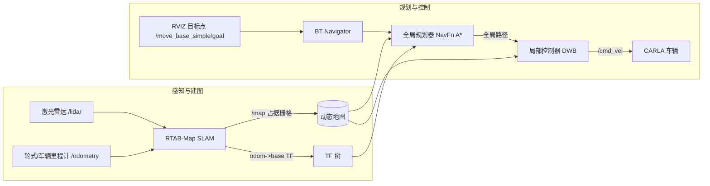

# 地面载具 SLAM 建图与自主导航同步仿真（CARLA + ROS2）

本文在 CARLA 仿真器上完成**任务三：在虚拟环境中对机器人建图与导航，导航与 SLAM 同步仿真**。
用车载激光雷达做 RTAB-Map 6 位姿 SLAM 实时建图，同时让 Nav2 导航栈在同一张动态地图上做全局路径规划与局部运动控制，
实现"边建图边导航"的闭环。代码位于 `src/ground/carla_slam_nav/`，全部支持 `ros2 launch`。

| 文件 | 角色 | 职责 |
| --- | --- | --- |
| `launch/carla_slam.launch.py` | 建图启动 | 拉起 RTAB-Map，订阅 `/carla/ego_vehicle/lidar` 与 `/odometry`，发布 `/map` 与 TF |
| `launch/carla_nav2.launch.py` | 导航启动 | 拉起 Nav2（BT 导航器 + NavFn 全局规划 + DWB 局部控制 + 双层代价地图） |
| `config/rtabmap_lidar.yaml` | SLAM 参数 | 点云建图、栅格分辨率、回环检测阈值等 |
| `config/nav2_params.yaml` | 导航参数 | 规划/控制/代价地图/速度约束 |

## 系统架构



## 计算原理

### 1. 占据栅格地图（Occupancy Grid）

把环境离散为栅格 \( m_i \)，每格用贝叶斯估计占据概率：

\[
P(m_i \mid z_{1:t}) = \left[1 + \frac{1-P(m_i\mid z_t)}{P(m_i\mid z_t)}\cdot\frac{1-P(m_i)}{P(m_i)}\cdot\frac{P(m_i\mid z_{1:t-1})}{1-P(m_i\mid z_{1:t-1})}\right]^{-1}
\]

激光每次扫描后对被命中/空闲栅格做对数几率（log-odds）更新，实现增量建图。

### 2. 位姿估计与回环

RTAB-Map 用激光点云匹配估计相邻帧位姿 \( \Delta T_{t-1,t} \)，累积得到里程计；
当观测与历史关键帧匹配成功时触发回环，后端图优化（g2p/g2o）修正累积漂移，输出一致性 `map→odom` 修正。

### 3. 全局路径规划（A*）

在占据栅格上以代价最小为目标搜索：

\[
f(n) = g(n) + h(n),\qquad h(n)=\lVert n-g\rVert_2
\]

\( g(n) \) 为起点到 \( n \) 的已代代价（含膨胀层代价），\( h(n) \) 为到目标的欧氏启发。

### 4. 局部运动控制（DWB）

对候选线速度 \( v \) 与角速度 \( \omega \) 采样，按多目标打分选最优：

\[
C(v,\omega) = k_{\text{goal}}\cdot\text{GoalDist} + k_{\text{obs}}\cdot\text{ObsDist} + k_{\text{path}}\cdot\text{PathAlign} + k_{\text{vel}}\cdot v
\]

## 仿真环境与步骤

!!! 环境
    Ubuntu 20.04 + ROS2 Humble；CARLA 0.9.10~0.9.15；已装 `rtabmap-ros`、`nav2-bringup`。

### 1. 安装依赖

```shell
sudo apt install ros-humble-rtabmap-ros ros-humble-nav2-bringup \
                 ros-humble-nav2-navfn-planner ros-humble-dwb-cruise-control
cd ~/ros2_ws
colcon build --packages-select carla_slam_nav
source install/setup.bash
```

### 2. 启动 CARLA 与带激光的 ego 车辆

```shell
./CarlaUE4.sh
# ros-bridge + 生成带 lidar 的车辆（沿用仓库 ros-bridge）
ros2 launch carla_ros_bridge carla_ros_bridge.launch.py town:=Town01
```

确认话题：

```shell
ros2 topic hz /carla/ego_vehicle/lidar        # 点云约 10Hz
ros2 topic echo /carla/ego_vehicle/odometry --once
```

### 3. 启动 SLAM 建图

```shell
ros2 launch carla_slam_nav carla_slam.launch.py
```

此时 RViz 中应看到逐步增长的占据栅格地图。

### 4. 启动 Nav2 导航

另开终端：

```shell
ros2 launch carla_slam_nav carla_nav2.launch.py
```

### 5. 给定初始位姿与目标

在 RViz 中：
1. `2D Pose Estimate` 点击车辆实际位置；
2. `2D Goal Pose` 点击目标点；车辆沿规划路径自主行驶，地图同步更新。

## 效果展示

> 录屏用 ScreenToGif，只录 RViz + 模拟器，压到 10MB 内放入 `docs/img/ground/`。

边建图边导航演示：


RViz 占据栅格与全局/局部路径截图：


## 性能评价（多场景）

| 场景 | 建图一致性(回环修正后) | 路径成功率 | 平均规划时长 ms | 平均跟踪误差 m | 到达率 |
| --- | --- | --- | --- | --- | --- |
| Town01 直道 | 待录屏填写 | 待填 | 待填 | 待填 | 待填 |
| Town02 窄弯 | 待录屏填写 | 待填 | 待填 | 待填 | 待填 |
| Town04 路口 | 待录屏填写 | 待填 | 待填 | 待填 | 待填 |

## 常见问题

* **`/map` 不出图**：检查 `/carla/ego_vehicle/lidar` 是否有点云、TF 中 `base_footprint→lidar` 是否存在；
* **导航原地旋转**：多为初始位姿不准，重新 `2D Pose Estimate`；
* **代价地图全膨胀**：调小 `inflation_radius`（config 里 1.0）。

## 参考

* [RTAB-Map 官方文档](https://github.com/introlab/rtabmap_ros)
* [Nav2 官方文档](https://navigation.ros.org/)
* [CARLA ros-bridge](https://github.com/carla-simulator/ros-bridge)
* 仓库页面：[手动控制 CARLA](./set_up_and_connect_to_carla.md)、[端到端强化学习驾驶](./rl_driving.md)
